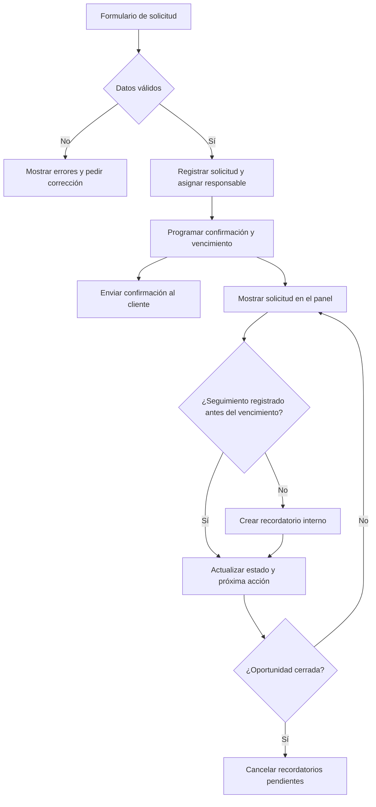

# Pyme FollowUp

**Seguimiento de solicitudes de presupuesto para pymes:** cada contacto queda
registrado, recibe una confirmación por correo y tiene un responsable y un
plazo. Si el plazo vence sin que nadie lo atienda, el sistema avisa.

> **Estado:** MVP funcional. Tiene formulario público, panel privado,
> confirmaciones, recordatorios y exportación CSV, y los once escenarios de
> aceptación de la especificación pasan como pruebas automáticas. Falta la
> evaluación comparativa con el proceso manual
> ([plan](docs/EVALUACION.md)): sus metas siguen siendo hipótesis.

## El problema

Las pymes de servicios reciben consultas por formularios, campañas y redes.
Cuando esas consultas viven en correos, notas y planillas sueltas, nadie
sabe con certeza quién tiene que responder ni qué oportunidades quedaron sin
seguimiento. El resultado son contactos que se enfrían, respuestas
duplicadas y un equipo que depende de su memoria.

**Pregunta del proyecto:** ¿en qué medida una herramienta así reduce el
tiempo de gestión y aumenta el porcentaje de solicitudes que reciben
seguimiento a tiempo? La mejora de ventas se considera un efecto posible
posterior y no se le atribuye a la herramienta sin medirla.

El caso de estudio es una empresa ficticia de remodelaciones. El mismo flujo
sirve para agencias, academias, talleres y cualquier negocio que trabaja
con presupuestos.

## Cómo funciona



- **Primer plazo de 48 horas corridas**, configurable. La confirmación
  automática no cuenta como seguimiento.
- **Una nota interna no cuenta como contacto.** Una llamada, un correo, una
  reunión o un presupuesto sí, y exigen fijar la próxima fecha o cerrar la
  oportunidad.
- **Estados:** `nueva` → `contactada` → `presupuesto_enviado` → `ganada`
  o `perdida`, con transiciones controladas.
- **Un proceso periódico (cron, cada 5 minutos)** crea los recordatorios
  vencidos y envía los correos pendientes, con hasta tres intentos (a 1 y a
  5 minutos). Antes de mandar un recordatorio vuelve a revisar la solicitud:
  si alguien la atendió o la cerró mientras esperaba, el aviso se cancela.

Las reglas completas están en la [especificación](docs/ESPECIFICACION.md).

## Arquitectura

| Componente | Implementación | Archivo |
| --- | --- | --- |
| Reglas del proceso | Python, sin dependencias web | `app/servicio.py` |
| Web | FastAPI, Jinja2, Bootstrap | `app/web.py`, `app/templates/` |
| Base de datos | SQLite, transacciones `BEGIN IMMEDIATE` | `app/db.py` |
| Proceso periódico | Comando para cron | `app/trabajador.py` |
| Correo | SMTP, o captura en la base para demo y pruebas | `app/correo.py` |
| Reloj | Inyectable: las pruebas avanzan el tiempo | `app/reloj.py` |

Se eligió así para mantener el costo y la complejidad del prototipo bajos.
Un despliegue con más concurrencia necesitaría otra base de datos y una
cola de trabajos.

## Probarlo

Requiere [uv](https://docs.astral.sh/uv/).

```bash
make setup   # dependencias
make demo    # datos ficticios; imprime la clave del panel
make run     # http://localhost:8000/solicitar (público) y /panel (privado)
make test    # 20 pruebas
```

Para crear un usuario propio:

```bash
PYTHONPATH=. uv run python -m scripts.crear_usuario "Nombre" email@empresa.cl
```

En producción hay que copiar `.env.example` a `.env`, definir
`PYME_CLAVE_SECRETA` y `PYME_PRODUCCION=true` (la app se niega a arrancar
sin clave propia), configurar SMTP y dejar `make trabajador` en cron cada 5
minutos.

## Pruebas

Cada escenario de aceptación de la especificación tiene su prueba en
`tests/test_aceptacion.py`, numerada igual:

| # | Escenario |
| --- | --- |
| 1 | Una solicitud válida aparece una sola vez y genera un trabajo de confirmación. |
| 2 | Una solicitud sin email válido muestra errores y no genera trabajos. |
| 3 | Repetir el mismo envío con la misma clave no crea duplicados. |
| 4 | Una solicitud sin contacto efectivo genera un recordatorio al vencer. |
| 5 | Registrar una nota interna no evita ese recordatorio. |
| 6 | Registrar un contacto y una próxima acción reemplaza el vencimiento anterior. |
| 7 | Cerrar una oportunidad cancela sus recordatorios pendientes. |
| 8 | Ejecutar el proceso dos veces no duplica el trabajo del mismo vencimiento. |
| 9 | Un fallo de correo respeta el límite de intentos y queda visible. |
| 10 | Una persona sin sesión no puede consultar ni exportar contactos. |
| 11 | Un cambio de estado con un recordatorio pendiente impide un aviso obsoleto. |

`tests/test_web.py` cubre lo demás de la especificación de seguridad:
protección CSRF, escape de HTML, neutralización de fórmulas en el CSV,
límite de envíos del formulario y conservación de los UTM de campaña.

Cada prueba se midió poniendo el defecto a mano y confirmando que falla.
La tabla está en [EVALUACION.md](docs/EVALUACION.md#pruebas-del-mvp).

## Seguridad y datos

- El formulario es público. El panel, la ficha y la exportación exigen
  sesión, y los formularios privados llevan protección CSRF.
- Las claves se guardan con scrypt. Un email inexistente tarda lo mismo en
  responder que uno existente, para no revelar qué cuentas hay.
- Las cabeceras de seguridad incluyen CSP, `X-Frame-Options` y `nosniff`. La
  cookie de sesión es `SameSite=Lax`, y además `Secure` en producción.
- El formulario está limitado a 5 envíos por minuto por IP. El límite vive
  en memoria, así que alcanza para un solo proceso.
- Los logs registran el tipo de error de envío, nunca el cuerpo del correo.
- La demo usa solo contactos ficticios y captura los correos en la base.

Antes de un piloto real hay que definir el aviso de privacidad, la base
legal del tratamiento y el plazo de conservación. Pedir un presupuesto no es
consentimiento para recibir publicidad.

## Fuera del MVP

Campañas masivas o seguimientos automáticos al cliente; integración con
WhatsApp, CRM o plataformas de anuncios; presupuestos automáticos;
predicción de ventas; y uso multiempresa.

## Desarrollo asistido por IA

El sistema no usa IA en su funcionamiento: son reglas y tareas programadas.
La IA se usó para desarrollarlo, y la [bitácora](docs/DESARROLLO_CON_IA.md)
registra qué se pidió, qué se revisó y qué se corrigió.

## Estructura

```text
pyme-followup/
├── app/            servicio, web, trabajador, correo, base de datos
├── tests/          escenarios de aceptación y seguridad
├── scripts/        demo y creación de usuarios
├── docs/           especificación, evaluación y bitácora
└── examples/       solicitudes ficticias
```

## Próximos pasos

1. Correr la evaluación comparativa con el proceso manual
   ([plan](docs/EVALUACION.md)).
2. Validar el flujo con una pyme real en un piloto acotado.
